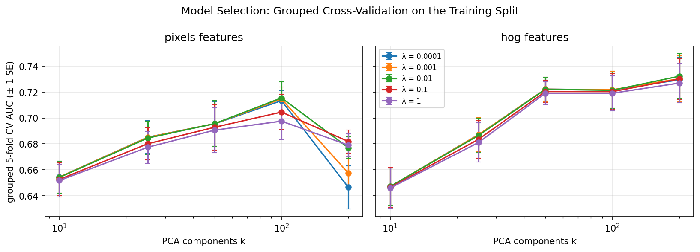

# Model selection and final evaluation

Notebook: `notebooks/6_experiment.ipynb`. Code: `src/porkqc/evaluate.py`, `src/porkqc/selection.py`.
Full results: `results/6_metrics.json`.

## Protocol

1. Grouped 5-fold cross-validation on the training split. Frames are grouped in
   blocks of 100 consecutive frame numbers (106 groups), so augmented copies and
   neighbouring frames of the same tray never fall on both sides of a fold.
   PCA is refitted inside each fold.
2. Grid: features ∈ {pixels, HOG}, k ∈ {10, 25, 50, 100, 200}, λ ∈ {1e-4, ..., 1}.
3. Selection: the smallest k within one standard error of the best CV AUC.
4. Alternative: an MLP with 64 hidden units, tuned the same way.
5. Threshold chosen on the validation split for 90 % recall; single test evaluation.

## Model selection

- HOG outperformed pixel features for k ≥ 50; λ had little effect.
- Best CV AUC: HOG, k = 200, λ = 0.01 (0.732 ± 0.017). Selected: HOG, k = 50,
  λ = 1e-4 (0.722), which is within one standard error and four times smaller.
- MLP best CV AUC: 0.717 (k = 50, α = 1), no better than logistic regression.

## Test results (80 images: 68 FAIL, 12 PASS)

Threshold 0.736 (from validation, 90 % recall target).

| Metric | Model | Always-FAIL baseline |
|---|---|---|
| AUC | 0.833 (95 % CI 0.65–0.95) | 0.500 |
| Recall | 0.735 (95 % CI 0.63–0.84) | 1.000 |
| Specificity | 0.833 (10/12) | 0.000 |
| Precision | 0.962 | 0.850 |
| Balanced accuracy | 0.784 | 0.500 |
| Accuracy | 0.750 | 0.850 |

Recall by defect type: unsealed 0.84 (n = 49), packaging-error 0.62 (n = 16),
loose meat 0.50 (n = 2), twisted meat 0.00 (n = 4).

MLP test AUC over three random seeds: 0.815, 0.771, 0.749.

Exposure robustness (×0.7 to ×1.3): test AUC 0.830–0.836.

## Findings

- **Accuracy is misleading**: the always-FAIL baseline scores higher accuracy
  (0.85) than the model (0.75) because 85 % of test images are FAIL.
- **The threshold did not transfer**: 90 % recall on validation became 74 % on
  test. With 106 FAIL validation images, the threshold estimate is noisy.
- **Estimates disagree across splits**: CV AUC 0.722, validation 0.784, test
  0.833. The grouped CV estimate uses the most images and controls leakage, so
  it is the most trustworthy; the higher test AUC may reflect neighbouring
  frames of the same trays appearing in both train and test, plus small-sample
  noise (the 95 % CI is 0.65–0.95).
- **Twisted meat is never caught**, and packaging-error recall is low; these
  defects are small or subtle and are not captured by 50 PCA components.
- **The MLP is less repeatable**: its test AUC varies by 0.066 with the random
  seed alone, whereas logistic regression has a unique solution.
- **Robust to exposure** well beyond the ±10 % training augmentation.
