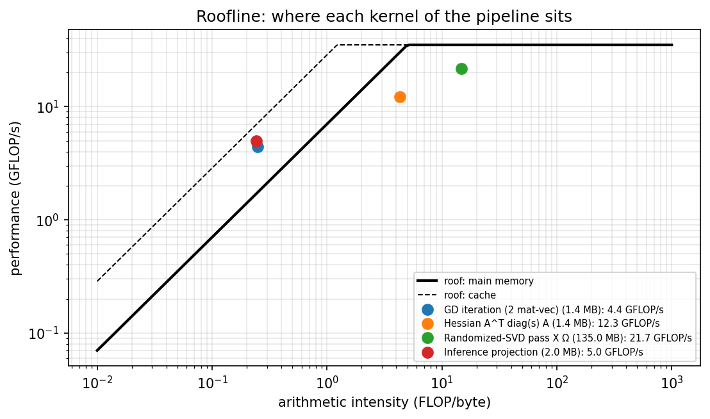

# Phase 7: Optimisation and performance

Notebook: `notebooks/7_optimisation.ipynb`. Code: `src/porkqc/perf.py`. Full results: `results/7_profile.json`.
Timings are for the Colab machine recorded in the notebook and vary between sessions.

## Machine

Measured peak 35.1 GFLOP/s (2000 x 2000 matrix multiplication), main-memory bandwidth
7.0 GB/s and cache bandwidth 28.6 GB/s (a = b + c).
Ridge point 5.0 FLOP/byte.

## Inference latency per image

| Stage | Standard decoding (ms) | Draft decoding (ms) |
|---|---|---|
| JPEG decode | 12.22 | 4.42 |
| HOG | 18.05 | 21.97 |
| PCA projection + classification | 0.32 | 0.41 |
| **Total** | **30.59** | **26.81** |
| Images per second | 33 | 37 |

Projection and classification take about 0.51 MFLOP per image; decoding and HOG dominate.

## Optimisation 1: reduced-resolution JPEG decoding

Decoding at half resolution with `Image.draft` is 1.1x faster per image. It changes the HOG
features by 17 % (relative norm), but accuracy is unchanged within
one standard error: grouped CV AUC 0.719 ± 0.011 vs 0.722 ± 0.009, validation AUC 0.784 vs 0.784.

## Optimisation 2: full vs randomized SVD

Relative gap between singular values 50 and 51: 0.011.

| Solver | Time (s) | Estimated GFLOP | Achieved GFLOP/s | Min subspace cosine | Directions with cosine > 0.99 |
|---|---|---|---|---|---|
| full | 82.01 | 526.6 | 6.4 | 1.000 | 50 |
| randomized_q0 | 1.36 | 4.1 | 3.0 | 0.026 | 7 |
| randomized_q4 | 2.16 | 20.8 | 9.6 | 0.366 | 42 |
| randomized_q10 | 3.25 | 45.8 | 14.1 | 0.989 | 49 |

The spectrum decays slowly at k = 50, so the randomized SVD needs about 10 power iterations to reproduce
the full SVD's subspace; with q = 10 it does so at a fraction of the cost.

## Optimisation 3: Newton's method vs gradient descent (tolerance 1e-6)

| k | Solver | Iterations | Time (ms) | MFLOP | AI (FLOP/byte) | cond(H) |
|---|---|---|---|---|---|---|
| 10 | newton | 4 | 10.3 | 4.0 | 0.68 | 2.6 |
| 10 | gd | 27 | 12.9 | 4.0 | 0.25 | 2.6 |
| 50 | newton | 5 | 22.0 | 91.8 | 2.69 | 7.5 |
| 50 | gd | 70 | 53.1 | 47.8 | 0.25 | 7.5 |
| 200 | newton | 6 | 449.5 | 1676.8 | 10.38 | 21.4 |
| 200 | gd | 237 | 353.4 | 638.1 | 0.25 | 21.4 |
| 400 | newton | 8 | 1014.7 | 9016.6 | 20.98 | 172.0 |
| 400 | gd | 2090 | 8228.5 | 11227.1 | 0.25 | 172.0 |

Gradient descent is memory-bound (AI 0.25) and its iteration count grows with the condition number;
Newton's method does more work per iteration, at higher arithmetic intensity, but needs only a few.

## Roofline

| Kernel | AI (FLOP/byte) | Working set (MB) | Achieved GFLOP/s |
|---|---|---|---|
| GD iteration (2 mat-vec) | 0.25 | 1.4 | 4.4 |
| Hessian A^T diag(s) A | 4.29 | 1.4 | 12.3 |
| Randomized-SVD pass X Ω | 14.74 | 135.0 | 21.7 |
| Inference projection | 0.24 | 2.0 | 5.0 |

The gradient-descent iteration and the inference projection have low arithmetic intensity (about 0.25
FLOP/byte), so they are memory-bound; they exceed the main-memory roof only because their data fits in
cache. The Hessian formation and the randomized-SVD pass have much higher intensity and run closer to peak.

## Memory

Training matrix 135 MB in float64; the deployed model
(PCA components, mean and weights) is 2.06 MB.

## Final design

- Inference: draft JPEG decoding + HOG + PCA (k = 50) + logistic regression, chosen because it is
  1.1x faster with no measurable loss of accuracy.
- PCA: randomized SVD with q = 10 for repeated fitting (cross-validation); the full SVD for the final model,
  where its cost is paid once.
- Classifier: Newton's method, which converges in a few iterations regardless of conditioning.
